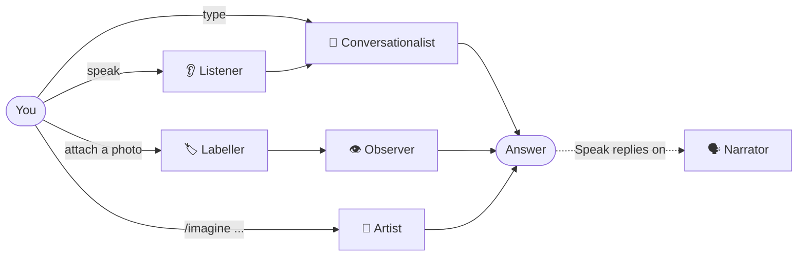

# 🤖 Multimodal Chatbot — A Plain-English Guide

This folder contains a small chatbot that can **read, see, listen, speak and draw**.
This guide explains what "multimodal AI" means and how this chatbot does it.
You don't need to be able to code to follow it.

> 📓 **Prefer to see the code in action?** The
> [walkthrough notebook](https://colab.research.google.com/github/jameel-learner/ai_training/blob/main/sprint1/day04/multimodal_chatbot_walkthrough.ipynb)
> runs each part of the chatbot step by step in Google Colab, in your browser, with nothing to install.

---

## 1. What does "multimodal" mean?

A **mode** is a type of information. People take in the world through several of them:

| Mode | Human equivalent | Example in this chatbot |
|---|---|---|
| Text | Reading and writing | You type a question and get a written answer |
| Image | Seeing | You attach a photo and ask "what's in this?" |
| Audio | Hearing and speaking | You ask a question out loud and the bot reads its answer back to you |

Early chatbots only handled **text**. A **multimodal** system handles several modes, and can
turn one into another: a photo into a description, speech into text, or a sentence into a picture.

---

## 2. The big idea: a team of specialists

There's no single AI that does everything here. The chatbot is a team of **six small
specialist AI models**. Each one is good at a single conversion:

| Specialist | What it does | Converts | Model it uses |
|---|---|---|---|
| 💬 **The Conversationalist** | Answers questions and keeps track of the conversation | Text → Text | Qwen 2.5 (0.5B) |
| 👁️ **The Observer** | Looks at an image and answers questions about it | Image + Text → Text | SmolVLM |
| 🏷️ **The Labeller** | Writes a short caption for an image | Image → Text | BLIP |
| 👂 **The Listener** | Writes down what you said | Speech → Text | Whisper |
| 🗣️ **The Narrator** | Reads text aloud | Text → Speech | MMS-TTS |
| 🎨 **The Artist** | Draws a picture from a description | Text → Image | SD-Turbo |

The chatbot itself is the **coordinator**. It works out what kind of input you gave,
sends it to the right specialist (or chain of specialists), and shows you the result.



**This is how most multimodal products are built.** Several models are chained together,
and text usually acts as the common language they pass between each other.

---

## 3. What happens when you…

### …type a question
1. Your message, plus the earlier conversation, goes to the **Conversationalist**.
2. It writes its answer **one word at a time**, and you see the words appear as it goes.
   This is called *streaming*. It's the same effect you see in ChatGPT or Claude.

### …attach a photo
1. The **Labeller** writes a one-line caption, for example *"a cat in an astronaut suit"*.
   It's shown under your photo.
2. The **Observer** looks at the photo together with your question and answers it.
3. The caption is saved in the conversation, so later questions can refer back to the photo.
   (The bot remembers the caption, not the image itself.)

### …record your voice (🎙️ in the sidebar)
1. The **Listener** turns your recording into text.
2. That text goes to the **Conversationalist**, just as if you had typed it.

### …type `/imagine a red sports car`
1. The **Artist** creates a new 512×512 image from your description.
2. On this laptop it takes about **10–60 seconds**.

### …turn on "🔊 Speak replies"
1. After any written answer, the **Narrator** turns it into audio, which plays automatically.

---

## 4. Key ideas, explained simply

| Term | What it means |
|---|---|
| **AI model** | A file of learned patterns, produced by training on huge amounts of examples. Think of it as a trained brain for one kind of task. |
| **Hugging Face** | The "app store" for open AI models. Thousands of free models can be downloaded from it. All six specialists here come from Hugging Face. |
| **Open model** | A model anyone can download and run for free. |
| **Pipeline** | A ready-made tool from Hugging Face that loads a model and runs it in one step. You just say what task you want, for example *"speech recognition with Whisper"*. |
| **Parameters (e.g. "0.5B")** | Roughly, the size of the model's brain. 0.5B means 0.5 billion. Bigger models are usually smarter but slower and heavier. ChatGPT-class models have hundreds of billions. |
| **Local vs. cloud** | *Local* means the model runs on your own computer. *Cloud* (or *API*) means you send your data to a company's servers and they run the model, usually for a fee. |
| **CPU vs. GPU** | A CPU is a computer's general-purpose processor. A GPU is a graphics chip that runs AI much faster. This chatbot runs on a plain laptop CPU. |
| **Streaming** | Showing the answer as it's being written, instead of waiting for the whole thing. |

---

## 5. Why everything runs locally (and for free)

The first version of this chatbot sent requests to **Hugging Face's cloud service**. That stopped
working once the free monthly credits ran out:

> *"Purchase pre-paid credits to continue using Inference Providers."*

So we moved every specialist onto the laptop itself. Both approaches are common in industry:

|  | ☁️ Cloud (API) | 💻 Local (this chatbot) |
|---|---|---|
| **Cost** | Pay per use | Free after the download |
| **Quality** | Large, very capable models | Small models: good enough for demos, but they make more mistakes |
| **Speed** | Fast (powerful servers) | Slower on an ordinary laptop |
| **Privacy** | Your data leaves your computer | Your data stays on your computer |
| **Internet** | Needed for every request | Needed only for the first download |
| **Setup** | An account and a key | About 6 GB of downloads the first time |

**Choosing between cloud and local is one of the main decisions in any AI product.**

---

## 6. Things you'll notice (and why)

- **The first use of each feature is slow.** Each specialist downloads once, which can take
  several minutes. After that it loads from the computer's storage.
- **Answers can be wrong or wander off topic.** These are small models, so they can get facts
  wrong. The Observer in particular tends to keep describing an image after it has answered
  the question.
- **The Listener sometimes mishears.** It's the smallest version of Whisper, so for example
  "multimodal chatbot" once came out as "multimobile chapat".
- **Pictures take a while.** Drawing is the heaviest task. A GPU would do it in about a second.

---

## 7. Run it on your own computer with VS Code

You only do steps 1–6 **once**. After that, step 7 is all you need each time.

There are two ways to go through each step, and you can mix them:

- **✋ Do it yourself:** copy and paste the commands shown.
- **💬 Ask an AI assistant:** paste the prompt shown into an AI coding assistant inside VS Code,
  and it runs the commands for you and explains what's happening.

### Setting up an AI assistant in VS Code (optional, recommended)
After you install VS Code (step 1), click the **Extensions** icon on the left (four small squares)
and install **one** of these:
- **Claude Code** (by Anthropic). It opens as a chat panel. Click the ✱ Claude icon at the top right of the editor.
- **GitHub Copilot Chat** (by GitHub). Use it in **Agent** mode so it can run commands.

**Tips for using the prompts:**
- Paste one prompt at a time and let it finish before sending the next.
- The assistant asks for permission before it runs a command or changes a file. Read what it
  plans to do, and approve it if it matches the step.
- If something fails, just tell it: *"That didn't work. Explain what went wrong in plain language and fix it."*
- 🔒 **Never paste passwords or tokens into the chat.** Step 6 shows how to add your token safely.

### What you need
- A laptop with **16 GB of memory** (8 GB may work but will be slow).
- About **10 GB of free disk space**: roughly 4 GB for the software and 6 GB for the AI models.
- An internet connection for the first setup (it's a few GB of downloads).
- About **30–60 minutes** the first time, mostly spent waiting for downloads.

---

### Step 1 — Install the three tools
| Tool | What it is | Where to get it |
|---|---|---|
| **Python 3.12** | The language the chatbot is written in | [python.org/downloads](https://www.python.org/downloads/). Choose version **3.12**. On Windows, **tick "Add python.exe to PATH"** on the first installer screen. |
| **Git** | A tool for downloading the project | [git-scm.com/downloads](https://git-scm.com/downloads). The default options are fine. |
| **VS Code** | The editor you'll work in | [code.visualstudio.com](https://code.visualstudio.com/) |

Then, in VS Code's **Extensions** panel, search for **"Python"** and install the one by **Microsoft**.

> 💬 **Prompt** (once your assistant is installed):
> ```
> I'm not a programmer. Check whether Python 3.12 and Git are installed on this
> computer. Tell me in plain language what's installed, what's missing, and how to
> install anything that's missing. Don't install or change anything yet.
> ```

### Step 2 — Download the project
1. In VS Code, press **Ctrl+Shift+P** (Mac: **Cmd+Shift+P**), type **Git: Clone**, and press Enter.
2. Paste the project address: `https://github.com/jameel-learner/ai_training`
3. Choose a folder to save it in. When VS Code asks, click **Open**.

> 💬 **Prompt:**
> ```
> Download (git clone) https://github.com/jameel-learner/ai_training into my
> Documents folder. Then tell me exactly how to open that folder in VS Code.
> ```
> Once the folder is open, start a **new** chat so the assistant works inside the project.

### Step 3 — Open the terminal
In VS Code's top menu choose **Terminal → New Terminal**. A panel opens at the bottom.
This is where commands go. Paste each one, press **Enter**, and wait for it to finish
before pasting the next. (If you're using the AI assistant, it uses this terminal for you.)

### Step 4 — Create a private workspace for the chatbot's software
This creates a folder called `.venv` that holds everything the chatbot needs, kept separate
from the rest of your computer. Then you *activate* it, which tells the terminal to use it.

**Windows**
```
py -3.12 -m venv .venv
.venv\Scripts\activate
```
**Mac**
```
python3.12 -m venv .venv
source .venv/bin/activate
```
It worked if the terminal line now starts with **`(.venv)`**.
If VS Code pops up *"We noticed a new environment… use it for this workspace?"*, click **Yes**.
From then on, every new VS Code terminal activates `.venv` automatically.

> 💬 **Prompt:**
> ```
> In this project's top folder, create a Python 3.12 virtual environment named .venv
> and set it as this VS Code workspace's Python interpreter. Explain briefly what a
> virtual environment is and why we need one.
> ```

### Step 5 — Install the chatbot's software (the longest step)
Make sure the terminal line starts with `(.venv)`, then run:

```
python -m pip install --upgrade pip
pip install -r sprint1/day04/requirements.txt
```
(The same commands work on Windows and Mac.)
Lots of text will scroll past. That's normal. You're done when the terminal stops and
shows a blinking cursor again.

> 💬 **Prompt:**
> ```
> Using the .venv virtual environment, install everything needed to run
> sprint1/day04/multimodal_chatbot.py from sprint1/day04/requirements.txt. When it's finished,
> check that streamlit, transformers, torch and diffusers can all be imported, and
> tell me in one sentence whether it worked.
> ```

### Step 6 — (Optional) Add a Hugging Face token
The chatbot works without one. A token only makes the model downloads faster and more reliable.
1. Create a free account at [huggingface.co](https://huggingface.co) and make a **Read** token at
   [huggingface.co/settings/tokens](https://huggingface.co/settings/tokens).
2. In VS Code's file list on the left, create a file named `.env` in the **top** `ai_training`
   folder (not inside `sprint1`). Put this one line in it:
   ```
   HF_TOKEN=hf_paste_your_token_here
   ```
3. Save it with **Ctrl+S** (Mac: **Cmd+S**). This file is private and is never uploaded anywhere.

> 💬 **Prompt** (the assistant prepares the file, and you paste the token yourself):
> ```
> Create a file named .env in this project's top folder containing the single line
> HF_TOKEN= and open it in the editor so I can paste my Hugging Face token after the
> = sign myself. Also confirm that .env is listed in .gitignore so it will never be
> uploaded to GitHub.
> ```

### Step 7 — Start the chatbot (do this every time)
In a VS Code terminal whose line starts with `(.venv)`, run:
```
streamlit run sprint1/day04/multimodal_chatbot.py
```
After a few seconds your web browser **opens the chatbot by itself** at **http://localhost:8501**.
If it doesn't, copy that address into your browser.

Try each mode: type a question, attach a photo with 📎, record your voice with 🎙️,
and type `/imagine a lighthouse at sunset`.
Remember that **the first use of each feature downloads its model** and can take several minutes.

**To stop the chatbot:** click in the terminal and press **Ctrl+C**.

> 💬 **Prompt:**
> ```
> Start the chatbot by running: streamlit run sprint1/day04/multimodal_chatbot.py
> using the .venv environment, and give me the link to open it in my browser.
> ```

### If something goes wrong
| You see… | What to do |
|---|---|
| `'py' is not recognized` or `python3.12: command not found` | Python isn't installed, or wasn't added to PATH. Reinstall Python 3.12 (on Windows, tick **"Add python.exe to PATH"**), then close and reopen VS Code. |
| `running scripts is disabled on this system` (when activating on Windows) | Windows is blocking the activation script. Run `Set-ExecutionPolicy -Scope CurrentUser RemoteSigned`, type **Y**, then try `.venv\Scripts\activate` again. This setting only affects your own user account. |
| `'streamlit' is not recognized` | The workspace isn't active (no `(.venv)` at the start of the line). Run the activate command from step 4 again. |
| `No such file or directory: requirements.txt` | The terminal is in the wrong folder. In VS Code use **File → Open Folder** and pick the top `ai_training` folder, then open a new terminal. |
| The 🎙️ microphone does nothing | Your browser asks for microphone permission the first time. Click **Allow**, or enable it from the 🔒 icon next to the address bar. |
| `Port 8501 is already in use` | The chatbot is already running in another terminal. Use that one, or stop it with **Ctrl+C**. |
| The computer becomes very slow | Close other heavy programs. Every model you've used stays loaded in memory until you stop the chatbot. |

> 💬 **Prompt for any error:**
> ```
> I'm not a programmer. I got this error while trying to [say which step]:
> [paste the error text here]
> Explain what it means in plain language, then fix it.
> ```

---

## 8. Put it on the internet (Streamlit Community Cloud, free)

Streamlit offers free hosting, so anyone with the link can use the chatbot without
installing anything.

### How the AI models work in the cloud
Nothing is uploaded from your laptop. When the cloud app first uses a feature, **Streamlit's
server downloads the model from Hugging Face**, just as your laptop did the first time.

The catch is that the free server is much smaller than a laptop:

|  | Your laptop | Free cloud server |
|---|---|---|
| Memory | ~16 GB | **~2.7 GB** |
| Processor | 8 cores | **2 cores**, no GPU |
| Downloaded models | Kept | **Lost** when the app sleeps after a period with no visitors, so they're downloaded again on the next visit |

So the chatbot **automatically switches to a "lite" team** when it runs in the cloud:

| Specialist | On your laptop | In the cloud |
|---|---|---|
| 💬 Conversationalist | Qwen 2.5 | **SmolVLM**, which also does the Observer's job, so one model does both |
| 👁️ Observer | SmolVLM | SmolVLM |
| 🏷️ Labeller (BLIP) | ✅ | ❌ Off (it would need ~1 GB more memory) |
| 👂 Listener (Whisper) | ✅ | ✅ |
| 🗣️ Narrator (MMS-TTS) | ✅ | ✅ |
| 🎨 Artist (`/imagine`) | ✅ | ❌ Off (it needs ~5 GB of memory) |

We measured the lite team at about **1.2 GB** with every model in use, comfortably under the limit.
Expect answers to be **less accurate** than on a laptop (in one test the cloud model said
India's capital is Mumbai) and replies to be **slower**, especially for images.
The first visit after the app has been asleep takes a few minutes while the models download.

### Deploy it (about 10 minutes)
1. Make sure the project is on **GitHub** in a **public** repository with your latest changes uploaded.
   *(Free hosting can read private repositories too, but it's simplest with a public one.)*
2. Go to [share.streamlit.io](https://share.streamlit.io) and **sign in with GitHub**.
3. Click **Create app** → **Deploy a public app from GitHub**, then fill in:
   - **Repository:** `jameel-learner/ai_training`
   - **Branch:** `main`
   - **Main file path:** `sprint1/day04/multimodal_chatbot.py`
   - **App URL:** pick a name, e.g. `multimodal-chatbot-demo`
4. *(Optional)* Open **Advanced settings**:
   - **Python version:** 3.12
   - **Secrets:** paste the line below (with your own token). It does the same job as `.env`
     on your laptop. The file `secrets.toml.example` shows the format.
     ```
     HF_TOKEN = "hf_paste_your_token_here"
     ```
5. Click **Deploy**. The first build takes **5–10 minutes** while it installs the software.
   You can watch the progress in the log panel.
6. Share the link. 🎉

> 💬 **Prompt** (before step 1, to upload your latest changes):
> ```
> I want to deploy sprint1/day04/multimodal_chatbot.py to Streamlit Community Cloud.
> Check that all the files it needs are committed and pushed to GitHub on the main
> branch, and that no secrets (.env or secrets.toml) would be uploaded. Show me what
> you plan to commit and wait for my OK before pushing.
> ```

> 💬 **Prompt** (if the cloud app shows an error):
> ```
> My Streamlit Community Cloud app for sprint1/day04/multimodal_chatbot.py failed.
> Here is the log from the "Manage app" panel:
> [paste the last part of the log here]
> Explain the problem in plain language and fix it in the code.
> ```

---

## 9. For the curious: where things live

| File | What's in it |
|---|---|
| `multimodal_chatbot.py` | The whole chatbot. Each specialist is a short, clearly named section (`chat_reply`, `vision_reply`, `caption_image`, `transcribe`, `speak`, `generate_image`). The cloud "lite" switch is near the top (`IS_CLOUD`). |
| `requirements.txt` | The list of free software libraries the chatbot needs. Streamlit Cloud reads this file to install them. |
| `secrets.toml.example` | A template showing how to give the cloud app your Hugging Face token. |
| `multimodal_chatbot_walkthrough.ipynb` | A step-by-step **Google Colab notebook** that runs each specialist on its own, with plain-English notes. Nothing to install. [Open it in Colab](https://colab.research.google.com/github/jameel-learner/ai_training/blob/main/sprint1/day04/multimodal_chatbot_walkthrough.ipynb). |

The screen itself (chat bubbles, sidebar, microphone button) is built with **Streamlit**,
a tool that turns a short Python script into a web page. That's why one command,
`streamlit run`, is all it takes to start it.
